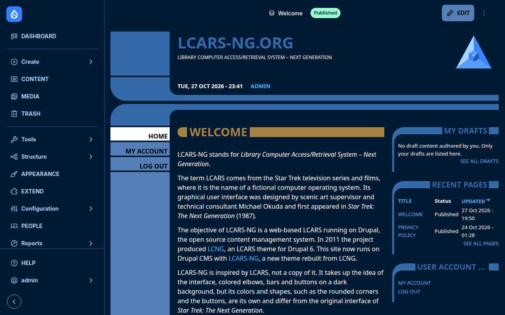
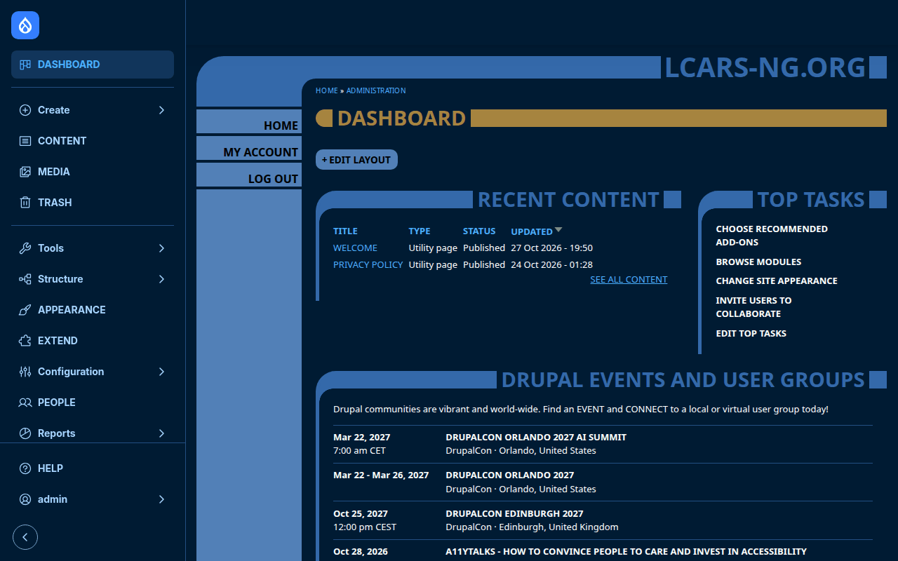

# LCARS-NG

LCARS-NG is a theme inspired by Michael Okuda's LCARS interface from
*Star Trek: The Next Generation*: rounded elbows, colored bars and buttons on
a dark background. It takes up the idea of the interface, but its colors and
shapes are its own. It is a rebuild of the Drupal 6 theme
[LCNG](https://github.com/LCARS-NG/LCNG) (2011) by the same author, on
current techniques: Twig, CSS Grid and custom properties, with no build step.
The CSS is served as it is in the repository. One small script sets the
corners of boxes by their width; without JavaScript everything stays usable.

The theme works as front-end theme and as administration theme. Its frame
adapts to the width and height of the screen, from phones to wide desktop
screens, for mouse and touch: it fills the window on short pages, and longer
pages scroll.

<p>
  <a href="images/screenshots/front-page.png"></a>
  <a href="images/screenshots/dashboard.png"></a>
</p>

- To see the theme on a live site, visit the
  [demo](https://demo.lcars-ng.org). The login form shows the credentials of
  a read-only guest account, which also opens the administration pages.
- For a full description of the theme, visit the
  [project page](https://www.drupal.org/project/lcars_ng).
- To submit bug reports and feature suggestions, or track changes, use the
  [issue queue](https://www.drupal.org/project/issues/lcars_ng).


## Requirements

This theme requires no modules outside of Drupal core (11.4 or later).


## Recommended modules

- The theme also styles the pages of Dashboard and Project Browser when they
  are installed, and shows the events of
  [Drupical](https://www.drupal.org/project/drupical) as an agenda. Layout
  Builder and CKEditor 5 of core take its dark colors as well.


## Installation

Install as you would normally install a contributed Drupal theme. For further
information, see
[Installing themes](https://www.drupal.org/docs/extending-drupal/installing-themes).

```bash
composer require drupal/lcars_ng
drush theme:install lcars_ng
drush config:set system.theme default lcars_ng
```

To use it for the administration pages as well, select it as administration
theme under *Appearance*.


## Configuration

*Appearance > Settings > LCARS-NG* offers five settings besides the logo and
favicon:

- **Login panel on the front page** (`front_page_login`, off by default):
  anonymous visitors see the login form in the LCARS login panel instead of
  the front page content, as in the Drupal 6 theme LCNG.
- **Navigation colors** (`navigation_scheme`, dark by default): the bars of
  the Navigation module on the left and at the top in the colors of the
  theme (*Dark*), in the colors of core (*Light*), or after the light or dark
  setting of the system of each user (*As the system*).
- **Contrast** (`contrast`, *As the system* by default): the frame, the texts
  in its color and the lines of boxes and fields in a quiet steel blue
  (*Standard*), lighter (*Medium*), or in light blue with lighter buttons and
  gold title bars (*High*). *As the system* shows Standard, and High to
  visitors whose system asks for more contrast (for example *Increase
  contrast* on macOS). In the contrast themes of Windows the frame, the
  buttons and the tabs keep their forms in the colors of the system.
- **Generated user pictures** (`generated_user_pictures`, on by default):
  users without a picture of their own get a pattern made from their
  account in place of the default picture of the field (where the field has
  one, as in Drupal CMS), as the identicons of GitHub: a grid of 5 by 5 cells, mirrored at its middle, in one of five
  colors of the theme. The pattern follows from the UUID of the account and
  stays the same; uploaded pictures are shown as they are.
- **Collapsed packages on Extend** (`collapse_module_packages`, on by
  default): the packages of modules on *Extend* start collapsed instead of
  open, where LCARS-NG is the administration theme. The filter above the list
  opens the packages with matching modules while it is in use.

The theme chooses its layout per page:

- **Frame** on all pages: elbows at the top and the bottom, menu buttons on
  the left, the content in between. On phones only the content remains, with
  the menus as a grid of buttons above the title.
- **Login panel** on the account pages (log in, register, reset password).
- **Two-part screen** on the front page for signed-in users and on user
  profiles: an upper panel with site name, logo and slogan, a status line with
  date, time and the signed-in user, the content below.
- **Red alert** on the pages for 401, 403 and 404.

Regions:

- `header`: header bar (site name), in the two-part screen the upper panel
- `panel_sidebar`, `panel`, `panel_status`: two-part screen only; buttons
  beside the upper panel, blocks in it, the curve below it
- `breadcrumb`: in the upper curve
- `sidebar`: menu buttons
- `highlighted`, `help`, `content`, `sidebar_second`
- `footer`: in the lower curve, blocks side by side; not shown in the login
  panel

With the [Klaro!](https://www.drupal.org/project/klaro) consent manager (part
of Drupal CMS), the consent notice is an LCARS panel floating above the bottom
elbow and its footer, and the consent dialog is a panel of the same kind. Their
titles are cut into the ceiling of the panel (the notice title with Klaro's
setting *Show notice title*); short titles such as "Privacy" and "Privacy
settings" fit best.

Colors and frame sizes are custom properties in `css/lcars/tokens.css`
(`--lcars-*`). A sub-theme can override them in its own stylesheet.

The theme provides four single-directory components to embed in templates:
button, heading, text and panel (`components/`). Button, heading and text
are deprecated and will be removed in 2.0.0: no template of the theme uses
them, so they are no longer tested on a site.


## Troubleshooting & FAQ

**Why does the theme override dialog styles of Gin and Claro?**
The module Gin Toolbar attaches the dialog styles of Gin and Claro to every
dialog in every theme. They rely on Gin's CSS variables and leave dialogs
transparent in other themes, so LCARS-NG removes them (`libraries-override`)
and styles dialogs in `css/components/dialog.css`.

**How do I get more contrast?**
The frame, the slogan, the date of the status line and the texts of the
login card share one steel blue, `--lcars-sidebar` (#3469aa, 3.11:1 on the
page background), so that the interface stays in the background. The setting
**Contrast** under *Appearance > Settings > LCARS-NG* sets it lighter for all
visitors: #579df9 (6.31:1) with *Medium*, #a7d4ff (11.21:1) with *High*. With
*As the system*, the default, each visitor gets High by turning on more
contrast in the settings of their system. A sub-theme can still set the
tokens in `css/lcars/tokens.css` to colors of its own.

**Can the login panel replace the "Access denied" page?**
Set the default 403 page to `/user/login` under *Configuration > System >
Basic site settings*. Anonymous visitors then get the login panel.


## Credits

- Design after the Drupal 6 theme LCNG (2011) by the same author, source:
  [github.com/LCARS-NG/LCNG](https://github.com/LCARS-NG/LCNG).
- `lcars-ng-logo.svg` is the logo of LCNG, redrawn as SVG: an icosahedron in
  a Schlegel diagram with 12 vertices and 30 edges. The theme logo
  `lcars-ng-logo-flat.svg` is derived from it as a flat mark: the faces
  joined to seven areas (three outer wings, a cube in the hexagon, the table
  in the middle), each in a solid blue of the palette, without gradients or
  transparency, on a transparent background. `lcars-ng-logo-facets.svg`, the
  theme logo up to 1.0.6, shows the 19 inner faces as a cut gem with shaded,
  slightly translucent facets; `lcars-ng-logo-glow.svg`, the theme logo up to
  1.0.2, shows the edges only, with a soft glow.
- `favicon.ico` (16, 32 and 48 px) shows the flat logo on a transparent
  background.
- The icons in `images/icons/` come from Drupal core (the Starterkit theme;
  `ex.svg`, `chevron-right.svg` and `chevron-down.svg` from `core/misc/icons`)
  and from the module View Password (`view-password-eye-*.svg`);
  `checkbox-check.svg` is the theme's own. The base styles in
  `css/components/` and most templates are based on the Starterkit
  (GPL-2.0-or-later).
- LCARS-NG is a fan work. It is not affiliated with or endorsed by the owners
  of Star Trek.


## License

LCARS-NG is licensed under the GNU General Public License, version 2 or
later (GPL-2.0-or-later), like Drupal core. The full text is in
`LICENSE.txt`; drupal.org also adds it to every release package.


## Maintainers

- Giang Ng
